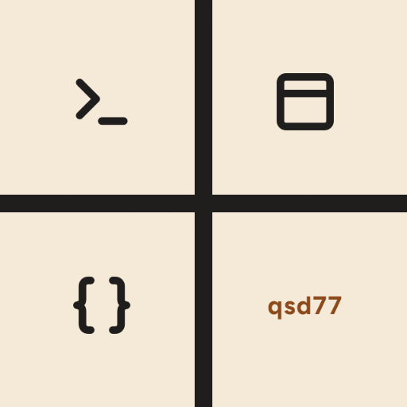

<p align="center">
  
</p>

<h1 align="center">qsd77</h1>

<p align="center">
  A short, friendly command for controlling
  <a href="https://github.com/dani-77/utumno">Utumno</a> from a terminal, a keybind, or a
  script — without typing out a full <code>qs ipc call ...</code> command every time.
</p>

---

> **Note:** [quickshell-d77](https://github.com/dani-77/quickshell-d77) is archived —
> [Utumno](https://github.com/dani-77/utumno) superseded it and now carries everything it
> had (dashboard, music picker and greeter included). qsd77 now targets Utumno by
> default; for an existing quickshell-d77 setup, add `-c quickshell-d77`.

## What is this?

Utumno is controlled through short remote commands — opening
the launcher, locking the screen, changing the wallpaper, and so on. `qsd77` wraps those
commands into a single, memorable tool, so instead of:

```sh
qs -c utumno ipc call launcher toggle
```

you just type:

```sh
qsd77 launcher
```

It talks to Utumno by default, and to any other Quickshell config (such as the
archived quickshell-d77) with one extra flag.

## Before you install

You need [Quickshell](https://quickshell.org) (the `qs` command) with
[Utumno](https://github.com/dani-77/utumno) already installed and running — `qsd77` is a
convenience wrapper around it, not a replacement.

## Installing

```sh
git clone https://github.com/dani-77/qsd77.git ~/qsd77
cd ~/qsd77
sudo make install
```

That builds the tool and installs it to `/usr/bin/qsd77`. To uninstall later:

```sh
sudo make uninstall
```

It's also packaged:

- **Arch Linux**: in the AUR as [`qsd77`](https://aur.archlinux.org/packages/qsd77)
  (`yay -S qsd77`); the same `PKGBUILD` is in [`packaging/arch`](packaging/arch/PKGBUILD).
- **Void Linux**: an `xbps-src` template is in
  [`packaging/void/qsd77`](packaging/void/qsd77/template) (a copy of the one in
  [`d77void/srcpkgs-d77`](https://github.com/d77void/srcpkgs-d77)).

## Using it

```sh
qsd77 launcher     # open the app launcher
qsd77 wallpaper    # open the wallpaper picker
qsd77 locker       # lock the screen
qsd77 session      # open the power/session menu
qsd77 dashboard    # open the dashboard
qsd77 ollama       # open the AI chat popup
```

By default these target Utumno. To talk to another config — for example an existing
quickshell-d77 setup — add `-c`:

```sh
qsd77 launcher -c quickshell-d77
qsd77 wallpaper -c quickshell-d77
```

### Launching a shell directly

`qsd77 run` starts a Quickshell config directly, instead of talking to one that's
already running — handy for a compositor's autostart:

```sh
qsd77 run                    # starts Utumno
qsd77 run -c quickshell-d77  # starts another config
```

### Shell autocompletion

Tab-completion for bash, fish and zsh can be generated on demand:

```sh
qsd77 completion bash
```

Follow your shell's usual instructions for loading a completion script (e.g. source the
output above from your `.bashrc`, or save it under your fish/zsh completions directory).

## Uninstalling

```sh
sudo make uninstall
```

## More

For the full command reference, including raw IPC passthrough for anything not covered
above, see the [technical documentation](doc/README.md).

## License

MIT — see [LICENSE](LICENSE).
